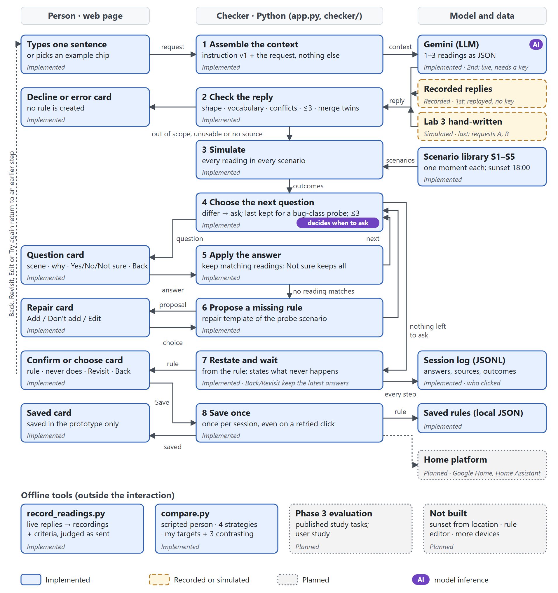

# Pre-save timing check for one-sentence home automations

*README prose: 1434 words (code, commands and file names not counted).*
Intelligent Interactive Systems, Assignment 2 (project Phase 2) · student 3189041 · submitted release `v1.1-a2`.

A person types one sentence, such as "Turn on the hallway light when I'm home after dark". Before saving, the
system asks up to three yes/no questions about concrete moments where Gemini's readings of the sentence differ or
where common rule bugs hide, proposes a missing rule when no reading fits an answer, and restates the rule,
including what it never does. No rule is saved without Save.



## Project status

| Part | Status |
|---|---|
| Web page: Describe / Check / Save flow; question, repair, review, decline, error and saved cards | Implemented |
| Back and Revisit: return to an earlier step or reopen an answer, with later answers kept and replayed; the latest answer wins | Implemented |
| Checker: reply and conflict checks, parts that can never fire, simulator, question choice (at most three), repairs, restatement, log | Implemented, 50 tests |
| Gemini readings, live with your own key | Implemented |
| Gemini replies to the seven example requests, replayed without a key | Recorded 2 Nov 2026 (`gemini-3.5-flash`); rechecked as sent 9 Nov |
| Lab 3 hand-written readings for requests A and B | Simulated; a fallback only |
| Offline comparison of question sources (`tools/compare.py`) | Implemented; pilot on my own intended behaviours and three contrasting ones fixed beforehand |
| Saving to Google Home or Home Assistant, sunset from location, a rule editor, more devices | Planned |
| Phase 3 evaluation on published study tasks; a user study | Planned |

## Technology

- **Python 3.11, standard library only**: the server (`http.server`, threaded as in the Lab 4 app), the
  checker in `checker/` and the tests.
- **One web page** in plain HTML, CSS and JavaScript (`web/index.html`).
- **Gemini** (`generateContent` with a response schema), chosen for its free tier and JSON output. Undecided:
  which model a deployed version would use.
- **Node 26 and headless Microsoft Edge**, only for `tools/capture.mjs` (diagram and storyboard frames).
- No retrieval and no agent framework: one model call per request.
- Written with **Claude Code** and **OpenAI Codex** (see AI assistance).

## Running or inspecting the work

```bash
py -3.11 app.py                  # or: python app.py   then open http://localhost:8000
py -3.11 -m unittest             # all tests, no network
py -3.11 tools/compare.py        # offline comparison of question sources
py -3.11 tools/record_readings.py --recheck   # the prompt's criteria on the recorded replies; no key
```

- Without a key, the example chips replay recorded Gemini replies; other sentences get a "no rule created" card.
- To use your own key, copy `.env.example` to `.env` and fill in `GEMINI_API_KEY` (Git ignores `.env`), then run
  `py -3.11 tools/record_readings.py --check`. Never commit a key.
- "How this was checked (for reviewers)", at the bottom of the page, shows what was sent to the model, its reply,
  the outcome table and why each question was chosen.
- Without running anything: `docs/storyboard_1.png` to `docs/storyboard_3.png` show three interactions, frame
  by frame.
- Each run writes `logs/sessions.jsonl` (not committed); `driver` is `capture-script` for scripted clicks and
  `browser` for clicks in a browser.

## Development record

Each commit message says what changed, why, and how it was checked. Unless a row says otherwise, Claude Code
made the change and ran the check; "I" marks my own decisions and checks.

| Stage | What changed and why | Checked | Commits |
|---|---|---|---|
| A1 and Lab 3 (Oct) | I proposed asking at most three questions where the model's readings differ. In the Lab 3 terminal prototype, Test B saved a rule that never turned the light off: both readings shared the error. The revision added bug-class probes and a proposed "off" rule. | Saved transcripts; output identical after a crash fix on import | [`8286c88`](https://github.com/TINGHUI-HUANG/PTC/commit/8286c88) [`96c7883`](https://github.com/TINGHUI-HUANG/PTC/commit/96c7883) |
| Rebuild and Gemini | Split into `checker/` for the interface; scenario S5 added. A live call with a versioned prompt replaced fixed readings, and replies are recorded for replay (`gemini-3.5-flash`, as older models are closed to new users). | Regression tests repeat Lab 3; the key never reaches the log; six criteria, `docs/prompt_log.md` | [`f4c9b8b`](https://github.com/TINGHUI-HUANG/PTC/commit/f4c9b8b) [`aa74484`](https://github.com/TINGHUI-HUANG/PTC/commit/aa74484) [`86120dd`](https://github.com/TINGHUI-HUANG/PTC/commit/86120dd) [`ac33ade`](https://github.com/TINGHUI-HUANG/PTC/commit/ac33ade) |
| Web page | Cards for each repair turn; the initiative rule in code. "light on (you said Yes)" contradicted the answer, so answers are now compared with outcomes. | Browser walk-throughs | [`de119ba`](https://github.com/TINGHUI-HUANG/PTC/commit/de119ba) |
| Probe fix | `compare.py` (the comparison A1 planned, as a pilot) showed probes wasted on conditions another rule covered; in E the missing "off" was never asked. Probes now apply only where the whole reading does nothing. | Exposed 8/9 → 9/9 deviations, correct rules 4/5 → 5/5, questions 13 → 10 | [`687dfbf`](https://github.com/TINGHUI-HUANG/PTC/commit/687dfbf) [`b191477`](https://github.com/TINGHUI-HUANG/PTC/commit/b191477) |
| My test and my changes (2 Nov) | I ran the prototype (below), then asked for Back and Revisit (later answers kept and replayed), rejection of rules that switch the light on and off at once, merging only of fully equivalent readings, retry-safe actions with session recovery, and a Describe / Check / Save interface with illustrated scenes. OpenAI Codex wrote these, and the commit's 12 new tests, from my requirements. | I reviewed the changes and tested them in the browser; Claude Code ran all 46 tests and the comparison | [`ddfa6bf`](https://github.com/TINGHUI-HUANG/PTC/commit/ddfa6bf) |
| Review and fixes (7–9 Nov) | At my request OpenAI Codex reviewed the project and reproduced four faults, and I decided to act on all four: Back could revive an answer I had changed (answers now carry versions and the latest wins); an "off" rule that can never fire passed as a reversal (checks now use what a rule can do); C1 and C3 were judged after the checker had repaired the reply (now judged as sent); "Try again" failed after a reload (a retry keeps its card). | The review's sequence as a test; 600 random Back and Revisit walks fail 38 times on the old code, never now; `--recheck`; I tested the fixed code myself | [`60f9cb0`](https://github.com/TINGHUI-HUANG/PTC/commit/60f9cb0) [`257dd7d`](https://github.com/TINGHUI-HUANG/PTC/commit/257dd7d) [`d999de9`](https://github.com/TINGHUI-HUANG/PTC/commit/d999de9) [`3a8d4aa`](https://github.com/TINGHUI-HUANG/PTC/commit/3a8d4aa) |
| Contrasting preferences | I asked for three people who want something else from C, D and E, fixed before the run. The combined source exposed 3 of 4 deviations, missing arrival after dark once a plain sunset rule is kept. Nothing was tuned in response. | `docs/comparison.md` | [`6c2748a`](https://github.com/TINGHUI-HUANG/PTC/commit/6c2748a) [`db20efb`](https://github.com/TINGHUI-HUANG/PTC/commit/db20efb) |
| Figures | Diagram and storyboards come from code and real screens (`tools/`). Frames showed Yes and Save pre-focused (a default answer) and a decline claiming rules were drafted; both fixed. | Every frame looked at | [`f6f5197`](https://github.com/TINGHUI-HUANG/PTC/commit/f6f5197) [`b3819c3`](https://github.com/TINGHUI-HUANG/PTC/commit/b3819c3) [`6ce6501`](https://github.com/TINGHUI-HUANG/PTC/commit/6ce6501) [`9acc3e2`](https://github.com/TINGHUI-HUANG/PTC/commit/9acc3e2) [`a8f6d60`](https://github.com/TINGHUI-HUANG/PTC/commit/a8f6d60) |
| Assessment round (11–12 Nov) | At my request Claude Code assessed the work against the brief and rubric. I corrected who wrote the 2 Nov changes (`ddfa6bf`) and chose to act on its findings: storyboards now start at the Describe step, state the goal, label who acts and show Back and Revisit; the diagram's footnotes became short labels. | Every frame looked at; 50 tests pass | this release |

## AI assistance

- **Claude Code** (Anthropic; Claude Opus 5.5, and Claude Fable 5.2 for the last round; desktop app). I asked it to read the brief, my A1 review, and the Week 1–4 slides, and to plan and build A2 with me. I approved its plan after adding two conditions: my Gemini key stays out of everything it writes, and it writes me a run guide in Chinese. It wrote the initial code, tests, prompt, figures, this README and the report draft, and ran and clicked through the app. On 9 Nov it fixed the faults the Codex review found, reran the checks and figures,
  and polished the report. On 11–12 Nov it assessed the work against the brief and rubric, then changed the
  figures, this README and the report's wording.
- **OpenAI Codex**. On 2 Nov it wrote the changes in `ddfa6bf` from my requirements: the interface, Back and
  Revisit, the server and check changes, and 12 tests. On 7 Nov it reviewed the project against the brief, at my
  request, and changed no files.
- **Gemini 3.5 Flash** proposes the readings at run time. It never sees the intended behaviours, and its replies
  pass the checks before anything reaches the screen. Only the example sentences were sent to it.


What I decided or checked myself:

- The topic, question and core design are from my A1 review.
- I wrote the intended behaviours for C–E before any model output. I first ticked only "home since 17:00, dark at
  18:00" for all three; when Claude asked whether "as soon as I get home after dark" really meant no light on
  arriving after dark, I changed all three to "on whenever I am home and it is dark; off when I leave".
- I created `.env` myself. I first pasted my key into `.env.example`, which Git tracks; Claude checked that no
  commit contained it, and I restored the template. Claude never wrote the key into a file or command.
- I ran the prototype myself on 2 Nov 2026; the log of that run is `docs/own_run_2026-11-02.jsonl`. For A, I
  said Yes to the light coming on at 18:00 although my sentence only mentions arriving, and added the proposed
  sunset rule. My door-lock request was declined with no rule created.
- After the Codex review I decided what to act on: the faults and the report's wording, plus the contrasting
  preferences. 

## Additional files

- `lab3/`: the Lab 3 prototype as imported, with its saved runs, diagrams and storyboard.
- `docs/`: diagram, storyboards and their screens, the comparison output, the prompt log and the log of my own
  run.
- `tools/`: recording, comparison, diagram, capture, storyboard and word-count scripts.
- The report is submitted separately; there is no ZIP.
